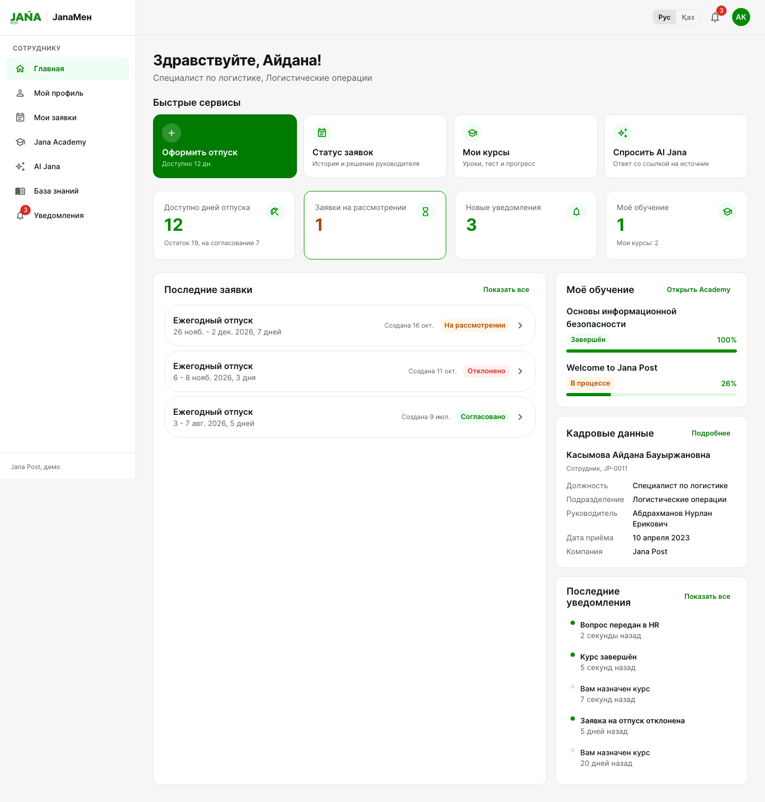

# JanaМен — единая HR-платформа сотрудника Jana Post

Прототип для **Jana Post × Terricon Valley Hackathon 2026, Challenge 02 — DIGITAL HR**.

Сотрудник входит в одно пространство и видит профиль, оформляет отпуск, отслеживает статус, проходит обучение в Jana Academy и получает ответы AI Jana со ссылкой на источник. Руководитель согласует заявки своей команды, HR управляет обучением, базой знаний и видит точки интеграции с 1С:ЗУП и Documentolog.

> Все люди, данные, учебные материалы и HR-документы в прототипе **синтетические** и не являются официальными материалами Jana Post.



## Быстрый старт

Нужен только Docker (Docker Desktop или Docker Engine + Compose v2).

```bash
cp .env.example .env        # необязательно: без .env всё работает с настройками по умолчанию
docker compose up --build
```

| Что | Адрес |
|---|---|
| Приложение | http://localhost:3000 |
| API (Swagger) | http://localhost:8000/docs |

Первый запуск собирает образы (несколько минут, зависит от сети); дальше старт контейнеров занимает около 10 секунд. База данных создаётся и заполняется демо-данными автоматически.

```bash
docker compose down                             # остановить
docker compose down -v                          # остановить и удалить демо-базу
docker compose exec backend python seed.py --reset   # пересоздать демо-данные (только демо-окружение)
```

Если порты 3000 или 8000 заняты, задайте `FRONTEND_PORT` и `BACKEND_PORT` в `.env`.

## Демо-аккаунты

Пароль для всех: **`JanaDemo2026!`**. На странице входа есть кнопки быстрого входа.

| Роль | Почта | Кто это |
|---|---|---|
| Сотрудник | `employee@janamen.example` | Айдана Касымова, специалист по логистике |
| Руководитель | `manager@janamen.example` | Нурлан Абдрахманов, руководитель логистики (4 подчинённых) |
| HR / администратор | `hr@janamen.example` | Сауле Ермекова, HR бизнес-партнёр |
| Руководитель другой команды | `manager2@janamen.example` | Динара Сулейменова, служба поддержки |
| Операционный директор | `director@janamen.example` | Согласует заявки руководителей |

Ещё сотрудники: `erlan@`, `maria@`, `kairat@`, `timur@`, `aliya@janamen.example`.

## Шесть сценариев демонстрации

| № | Сценарий | Где смотреть |
|---|---|---|
| 1 | Сотрудник видит профиль, быстрые сервисы, заявки, обучение и уведомления | Вход как сотрудник → «Главная» (блок «Быстрые сервисы»), «Мой профиль» |
| 2 | Заявка на отпуск → решение руководителя → статус и уведомление | Сотрудник: «Быстрые сервисы» → «Оформить отпуск». Руководитель: «Команда» → «Согласовать». Сотрудник: колокольчик |
| 3 | Руководитель видит только свою команду | Руководитель: «Команда» → «Сотрудники» (нет сотрудников Динары). Сотрудник: `/team` → «Нет доступа» |
| 4 | HR назначает курс → сотрудник проходит → результат сохранён | HR: «Обучение» → «Назначить курс». Сотрудник: уведомление → уроки → тест → профиль |
| 5 | AI Jana отвечает по базе знаний со ссылкой на источник | «AI Jana» → «Сколько дней ежегодного отпуска положено?» → карточка источника |
| 6 | Вопрос вне базы → AI Jana не выдумывает и предлагает HR | «AI Jana» → «Положена ли мне компенсация за спортзал?» → «Обратиться в HR» |

Пошаговый сценарий защиты: [docs/DEMO_SCRIPT.md](docs/DEMO_SCRIPT.md).

## AI Jana

```
вопрос → защита (чужие данные, кадровые решения) → поиск по базе знаний
       → проверка релевантности → LLM строго по найденным фрагментам → ответ + источники
```

- **База знаний** — 5 синтетических документов с идентификатором и версией ([backend/knowledge_base](backend/knowledge_base)). HR редактирует их в интерфейсе, версия растёт автоматически, ассистент сразу использует новую версию.
- **Без выдумок.** Ниже порога релевантности — отказ и кнопка «Обратиться в HR», а не случайная цитата. Ответ LLM без ссылки на переданный фрагмент отбрасывается, а карточка источника указывает тот раздел документа, на котором основан ответ.
- **Приватность.** Вопросы о данных других сотрудников и просьбы принять кадровое решение отклоняются до поиска. В LLM уходят только фрагменты базы знаний и текст вопроса; профили, заявки и данные коллег не передаются. Личные вопросы (остаток, свои заявки и курсы) отвечаются из БД вообще без LLM.
- **Провайдер LLM настраивается** в `.env`:

| `LLM_PROVIDER` | Ключ | Модель по умолчанию |
|---|---|---|
| `openrouter` (основной) | `OPENROUTER_API_KEY` | `anthropic/claude-opus-5.5` |
| `anthropic` (дополнительный) | `ANTHROPIC_API_KEY` | `claude-opus-5-5` (effort `low`, server-side fallback при отказе модели) |
| `none` или ключ не задан | — | режим «только база знаний»: ответ — цитата найденного раздела с источником |

Без ключа и без сети AI Jana полностью работает в режиме «только база знаний» — текущий режим показан на странице ассистента. Ключи хранятся только на backend и не передаются во frontend.

## Архитектура

React 18 + MUI (nginx) → FastAPI + SQLAlchemy + SQLite. Права проверяются на backend в одном модуле, интеграции подключаются через порты с mock-адаптерами.

- [docs/ARCHITECTURE.md](docs/ARCHITECTURE.md) — схема, модель данных, workflow, AI-конвейер.
- [docs/INTEGRATIONS.md](docs/INTEGRATIONS.md) — 1С:ЗУП и Documentolog: что синхронизируется и где подключается.
- [docs/SECURITY.md](docs/SECURITY.md) — модель доступа, закрытые уязвимости, подготовка чистого репозитория.

## Что реализовано, смоделировано и оставлено на развитие

| Статус | Что |
|---|---|
| **Реализовано полностью** | Вход и 3 роли с проверкой прав на backend; профиль с read-only кадровыми данными; заявка на отпуск со статусами, историей, комментарием и запретом самосогласования; раздел команды; центр уведомлений; Jana Academy (курсы, уроки, тест с проверкой на сервере, прогресс, назначения HR); AI Jana с источниками, отказами, эскалацией и редактируемой базой знаний; RU/KZ-интерфейс; адаптивная вёрстка |
| **Смоделировано** | 1С:ЗУП — mock-адаптер выдаёт синтетическую оргструктуру; Documentolog — mock-адаптер «создаёт» приказ после согласования; все вызовы пишутся в журнал интеграций (HR → «Интеграции») |
| **Развитие** | Реальные адаптеры 1С:ЗУП и Documentolog; заявка «Аванс» (тип заявки заложен в модель); база знаний на казахском; email/push; PostgreSQL и миграции Alembic; httpOnly-cookie вместо `localStorage`; rate limiting входа |

Подробная матрица требований: [docs/COMPLIANCE.md](docs/COMPLIANCE.md).

## Тесты

```bash
# backend: 209 API-тестов: права и IDOR, workflow отпуска и отзыв согласования, Academy, AI evaluation, личный контекст, журнал пробелов
docker compose exec backend python -m pytest

# e2e: 17 сценариев в браузере (Playwright) против запущенного стека
cd e2e && npm ci && npx playwright install chromium
E2E_BASE_URL=http://localhost:3000 E2E_RESET=1 npx playwright test
```

`E2E_RESET=1` пересоздаёт демо-данные перед прогоном.

## Разработка без Docker

```bash
# backend (Python 3.11+)
cd backend && pip install -r requirements.txt && python seed.py && uvicorn app.main:app --reload
# frontend (Node 20+), прокси /api → http://localhost:8000
cd frontend && npm ci && npm run dev      # http://localhost:5173
```

## Структура

```
backend/
  app/
    permissions.py       # все правила доступа
    services/            # заявки, уведомления, Academy
    ai/                  # AI Jana: поиск, защита, LLM, ассистент
    integrations/        # порты + mock 1С:ЗУП и Documentolog
    routers/             # REST API
  knowledge_base/        # документы базы знаний (Markdown + front matter)
  seed_data/             # синтетическая оргструктура и курсы
  tests/                 # pytest
frontend/src/
  theme/                 # дизайн-токены Jana Post
  i18n/                  # ru / kk
  pages/, components/
e2e/                     # Playwright
docs/                    # архитектура, требования, безопасность, сценарий демо
```

## Атрибуция

Логотип Jana Post взят с [janapost.kz](https://www.janapost.kz) без изменений и используется только в рамках хакатона Jana Post; цветовые токены восстановлены по публичному CSS сайта ([docs/JANA_BRAND_RESEARCH.md](docs/JANA_BRAND_RESEARCH.md)).
