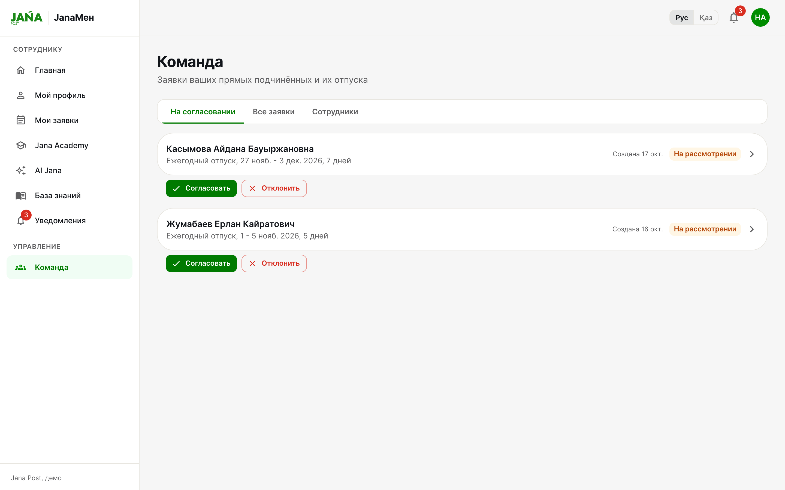
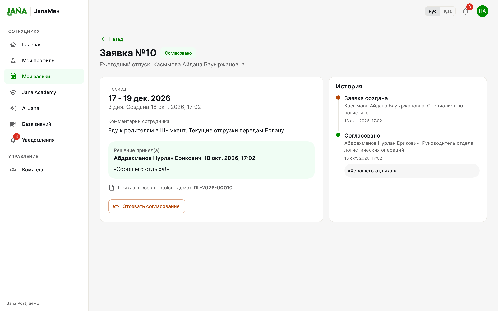
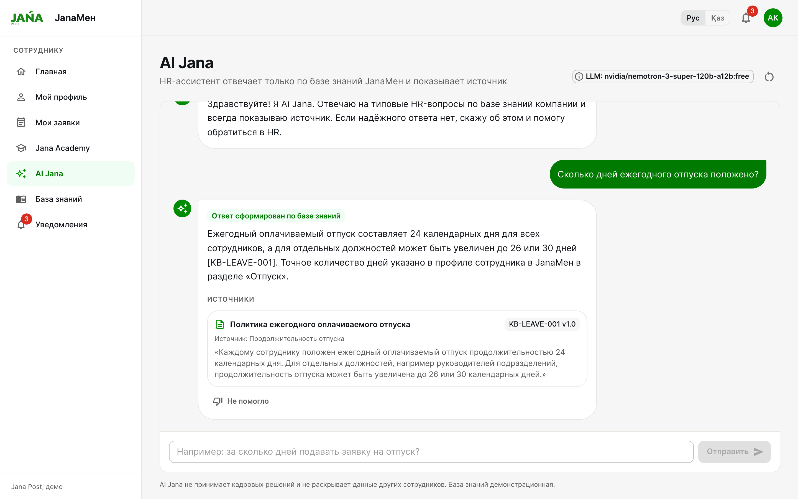
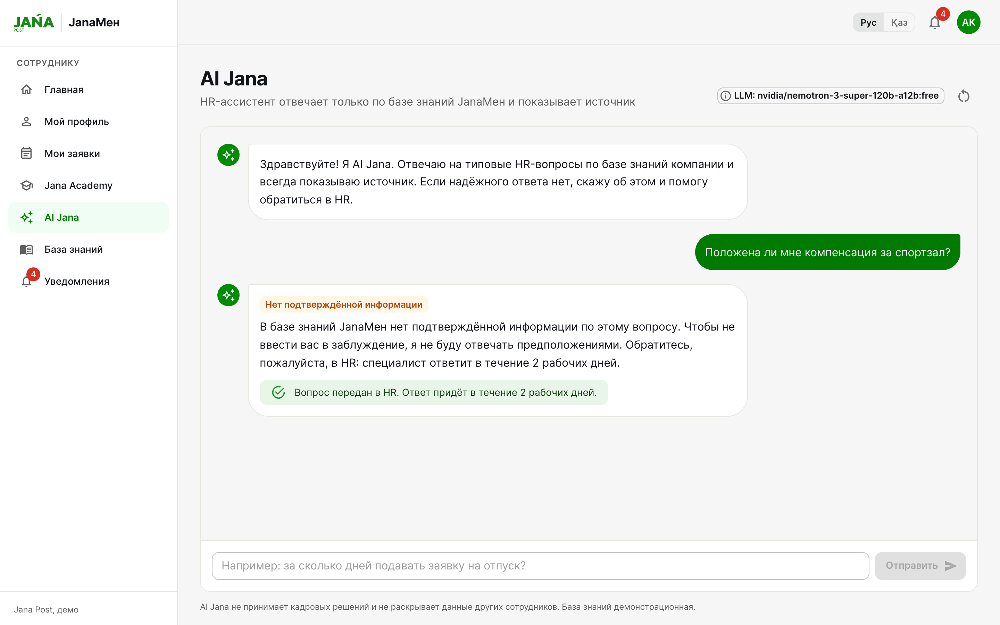
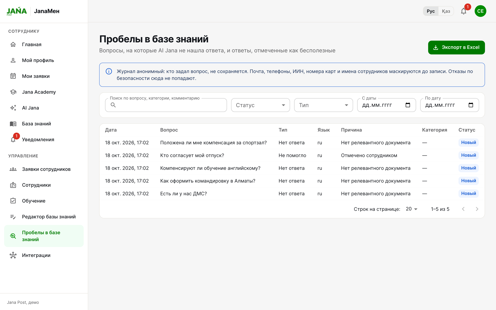
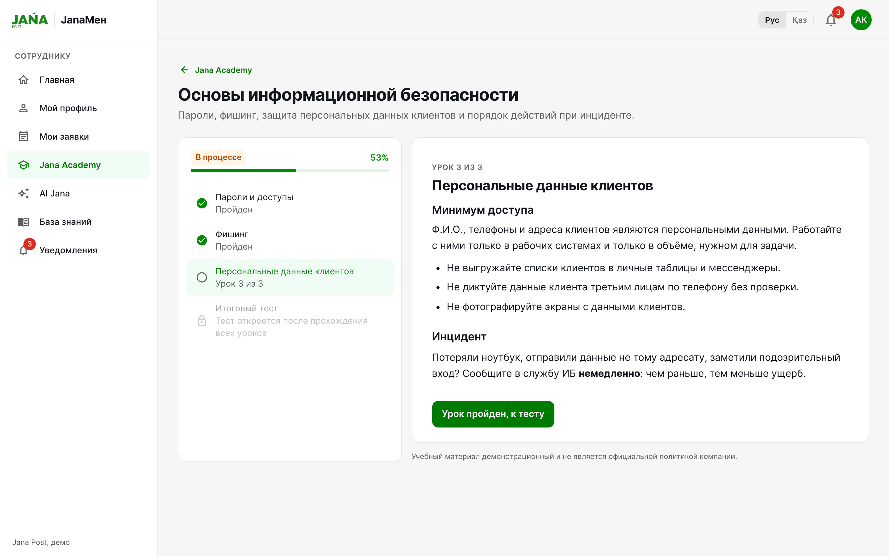

# JanaМен

HR-портал для сотрудников Jana Post. Сделан на хакатоне Jana Post × Terricon Valley 2026, кейс 02 «Digital HR».

Сотрудник заходит и сразу видит, сколько у него дней отпуска, что с его заявками и какие курсы ему назначили. Отпуск оформляется с главной страницы. Руководитель согласует его у себя в разделе «Команда», после чего в Documentolog уходит приказ. HR назначает курсы, правит базу знаний и смотрит, на какие вопросы AI Jana ответить не смогла.

Все люди, документы и курсы в прототипе выдуманы. Это не данные и не политики Jana Post.


<table>
  <tr>
    <td width="50%"><br>Руководитель видит заявки только своих подчинённых</td>
    <td width="50%"><br>После согласования у заявки появляется номер приказа</td>
  </tr>
  <tr>
    <td><br>AI Jana отвечает по базе знаний и показывает, откуда взят ответ</td>
    <td><br>Если в базе ответа нет, вопрос уходит в HR</td>
  </tr>
  <tr>
    <td><br>HR видит вопросы, на которые не нашлось ответа</td>
    <td><br>Курс в Jana Academy: уроки, прогресс, в конце тест</td>
  </tr>
</table>

Интерфейс есть на казахском ([скрин](docs/screenshots/kz-dashboard.png)), вёрстка работает на телефоне ([скрин](docs/screenshots/mobile-dashboard.png)).

## Запуск

Нужен только Docker с Compose v2.

```bash
cp .env.example .env    # можно пропустить, без .env тоже запустится
docker compose up --build
```

Приложение откроется на http://localhost:3000, Swagger на http://localhost:8000/docs. Первая сборка занимает несколько минут, потом контейнеры поднимаются секунд за десять. База создаётся при старте и сразу заполняется демо-данными.

```bash
docker compose down                                   # остановить
docker compose down -v                                # остановить и стереть базу
docker compose exec backend python seed.py --reset    # вернуть демо-данные к исходным
```

Если 3000 или 8000 заняты, поменяйте `FRONTEND_PORT` и `BACKEND_PORT` в `.env`.

## Кем войти

Пароль у всех `JanaDemo2026!`. На странице входа есть кнопки для трёх основных ролей.

| Роль | Почта | Кто |
|---|---|---|
| Сотрудник | `employee@janamen.example` | Айдана Касымова, специалист по логистике |
| Руководитель | `manager@janamen.example` | Нурлан Абдрахманов, у него 4 подчинённых |
| HR | `hr@janamen.example` | Сауле Ермекова, HR бизнес-партнёр |
| Руководитель другого отдела | `manager2@janamen.example` | Динара Сулейменова, служба поддержки |
| Операционный директор | `director@janamen.example` | согласует отпуска самих руководителей |

Есть ещё рядовые сотрудники: `erlan@`, `maria@`, `kairat@`, `timur@`, `aliya@janamen.example`.

## Что посмотреть

1. Войти сотрудником. На главной видны остаток отпуска, последние заявки, курсы и уведомления.
2. Нажать «Оформить отпуск» и отправить заявку. Потом войти руководителем, открыть «Команда» и согласовать. У сотрудника загорится колокольчик. Пока отпуск не начался, руководитель может отозвать согласование.
3. Руководитель видит только свою команду: сотрудников Динары у Нурлана нет. Если сотрудник откроет `/team`, получит «Нет доступа».
4. Войти HR, в «Обучении» назначить курс. Сотрудник проходит уроки и тест, результат сохраняется в профиле.
5. Спросить AI Jana «Сколько дней ежегодного отпуска положено?». В ответе будет карточка документа, на который он опирается.
6. Спросить «Положена ли мне компенсация за спортзал?». Такого в базе нет, AI Jana честно скажет об этом и предложит отправить вопрос в HR. У HR этот вопрос появится в «Пробелах в базе знаний».

Сценарий защиты по шагам лежит в [docs/DEMO_SCRIPT.md](docs/DEMO_SCRIPT.md).

## AI Jana

AI Jana отвечает только по базе знаний. Сейчас в ней пять документов, они лежат в [backend/knowledge_base](backend/knowledge_base) как Markdown с номером версии. HR может править их прямо в интерфейсе, и ассистент сразу начинает отвечать по новой версии.

Как проходит вопрос:

```
вопрос → фильтр (чужие данные, кадровые решения) → поиск по базе
       → достаточно ли похоже? → LLM пишет ответ по найденным фрагментам → ответ + источник
```

Вопросы про коллег и просьбы что-то решить за HR отсекаются ещё до поиска. Если подходящего раздела не нашлось, модель не вызывается вообще: сотрудник получает отказ и кнопку «Обратиться в HR». Если модель вернула ответ без ссылки на переданный ей фрагмент, такой ответ выбрасывается.

Про себя можно спрашивать: «сколько у меня осталось дней», «что с моей заявкой», «какие курсы мне назначены». Это собирается прямо из базы данных, без модели. Руководителю тем же путём показываются заявки, которые ждут его решения.

В модель уходят только текст вопроса и найденные куски документов. Профили, заявки и данные коллег туда не попадают. Ключи хранятся на бэкенде, во фронтенд они не передаются.

Вопросы без ответа и ответы с отметкой «Не помогло» попадают в журнал пробелов. Кто спрашивал, там не хранится, а почта, телефоны, ИИН и имена маскируются до записи. HR выгружает журнал в Excel или прямо из записи начинает новый раздел базы знаний. Подробнее в [docs/KNOWLEDGE_GAPS.md](docs/KNOWLEDGE_GAPS.md).

Модель задаётся в `.env`:

| `LLM_PROVIDER` | Ключ | Модель по умолчанию |
|---|---|---|
| `openrouter` | `OPENROUTER_API_KEY` | `anthropic/claude-opus-5.5` |
| `anthropic` | `ANTHROPIC_API_KEY` | `claude-opus-5-5` |
| `none` или ключа нет | | без модели: AI Jana цитирует найденный раздел |

Другую модель можно указать в `LLM_MODEL`. Без ключа и без интернета AI Jana тоже работает, просто вместо пересказа показывает цитату. Текущий режим написан в шапке страницы ассистента.

## Что сделано, а что нет

Работает целиком: вход и три роли с проверкой прав на бэкенде, профиль, заявки на отпуск с историей, комментариями, отзывом согласования и запретом согласовывать самому себе, раздел команды, уведомления, Jana Academy с тестом, который проверяется на сервере, AI Jana с журналом пробелов, интерфейс на русском и казахском, мобильная вёрстка.

Вместо 1С:ЗУП и Documentolog стоят заглушки. Первая отдаёт выдуманную оргструктуру, вторая «создаёт» приказ после согласования. Каждый вызов пишется в журнал, его видно у HR в разделе «Интеграции». Чтобы подключить настоящую систему, достаточно написать адаптер под тот же интерфейс, см. [docs/INTEGRATIONS.md](docs/INTEGRATIONS.md).

Не успели: настоящие адаптеры, заявку на аванс (тип в модели данных уже есть), базу знаний на казахском, email и push, PostgreSQL с миграциями, httpOnly-cookie вместо `localStorage`, ограничение попыток входа.

Сверка с требованиями кейса по пунктам: [docs/COMPLIANCE.md](docs/COMPLIANCE.md).

## Тесты

На бэкенде 209 тестов: права доступа, отпуска, Academy, ответы AI Jana, журнал пробелов. Ещё 17 сценариев гоняются в браузере через Playwright.

```bash
docker compose exec backend python -m pytest
```

```bash
cd e2e && npm ci && npx playwright install chromium
E2E_BASE_URL=http://localhost:3000 E2E_RESET=1 npx playwright test
```

`E2E_RESET=1` перед прогоном сбрасывает демо-данные.

## Без Docker

Бэкенд, Python 3.11+:

```bash
cd backend && pip install -r requirements.txt && python seed.py && uvicorn app.main:app --reload
```

Фронтенд, Node 20+. Откроется на http://localhost:5173, запросы `/api` проксируются на :8000.

```bash
cd frontend && npm ci && npm run dev
```

## Где что лежит

```
backend/app/
  permissions.py     все правила доступа в одном месте
  services/          заявки, уведомления, Academy
  ai/                AI Jana: фильтр, поиск, LLM, журнал пробелов
  integrations/      интерфейсы и заглушки 1С:ЗУП и Documentolog
  routers/           REST API
backend/knowledge_base/   документы базы знаний
backend/seed_data/        оргструктура и курсы для демо
frontend/src/             React 18 + MUI, переводы в i18n/
e2e/                      Playwright
docs/                     архитектура, безопасность, сценарий демо
```

Стек: React 18 и MUI за nginx, FastAPI, SQLAlchemy, SQLite. Схема и модель данных описаны в [docs/ARCHITECTURE.md](docs/ARCHITECTURE.md), модель доступа в [docs/SECURITY.md](docs/SECURITY.md).

## Логотип

Логотип Jana Post взят с [janapost.kz](https://www.janapost.kz) без изменений и используется только в рамках хакатона. Цвета сняты с публичного CSS сайта, как именно, записано в [docs/JANA_BRAND_RESEARCH.md](docs/JANA_BRAND_RESEARCH.md).
