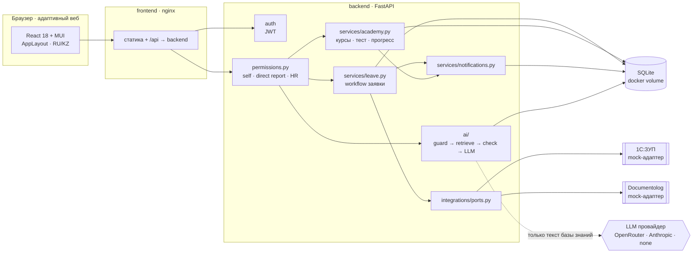
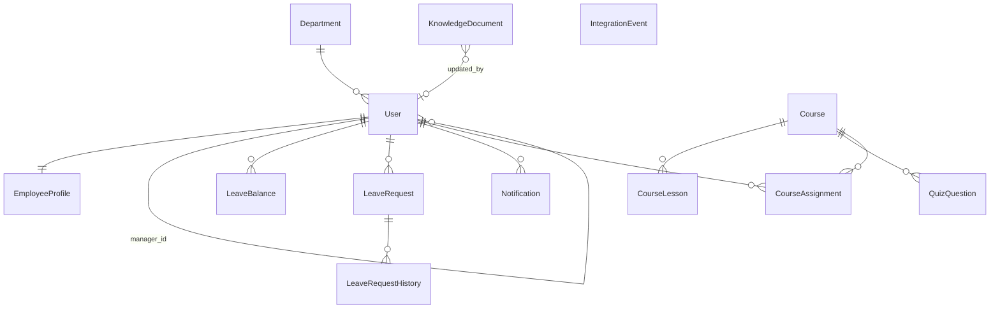
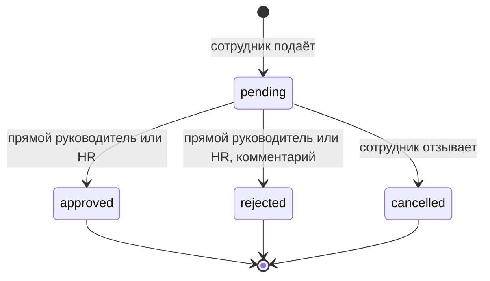

# JanaМен — архитектура

Документ описывает реализованную систему (состояние после Phase 5). Модульный монолит: один FastAPI-сервис и одно SPA.

## 1. Общая схема



## 2. Принципы

1. **Права проверяет backend.** Все правила — в `backend/app/permissions.py`. Фронтенд скрывает недоступные разделы только для удобства; маршрутные guard-ы дублируют, а не заменяют серверные проверки.
2. **Отношение вместо флагов.** Для объекта вычисляется отношение пользователя к владельцу: сам, прямой руководитель (`manager_id`) или HR. Чужие объекты по ID возвращают 404.
3. **Официальные данные — read-only.** ФИО, должность, подразделение, руководитель, дата приёма и право на отпуск приходят из 1С:ЗУП (mock). Сотрудник меняет только личный телефон и язык интерфейса; схема `PATCH /me` с `extra="forbid"` отвечает 422 на любое другое поле.
4. **Переходы статусов — в одном месте.** `services/leave.py` — единственный код, меняющий статус заявки. История, баланс, уведомления и передача в Documentolog не могут быть пропущены.
5. **AI не выдумывает.** Ответ о правилах компании без источника невозможен по построению (раздел 6).

## 3. Структура backend

```
backend/app/
  main.py                 сборка приложения, роутеры, загрузка базы знаний при старте
  config.py               Settings из env (SECRET_KEY, LLM_*, CORS)
  database.py             engine, сессии, PRAGMA foreign_keys
  auth.py                 bcrypt, JWT
  permissions.py          get_current_user, require_roles, правила доступа
  models.py               SQLAlchemy-модели
  schemas.py              Pydantic-схемы (строгие тела запросов, UTC-время)
  services/
    leave.py              workflow заявки на отпуск
    academy.py            назначения, уроки, проверка теста
    notifications.py      notify()
    views.py              сборка DTO, баланс отпуска
  ai/
    knowledge.py          загрузка и разбиение документов по разделам
    retriever.py          TF-IDF по символьным n-граммам + покрытие слов вопроса
    guard.py              чужие персональные данные, кадровые решения
    llm.py                OpenRouterProvider, AnthropicProvider, выбор по env
    assistant.py          конвейер и инварианты
  integrations/
    ports.py              HRMasterDataProvider, DocumentFlowProvider
    mock_1c_zup.py        синтетическая оргструктура
    mock_documentolog.py  «создание» приказа на отпуск
  routers/                auth, me, requests, team, notifications, academy, ai, admin
knowledge_base/*.md       документы AI Jana
seed_data/                org.json, courses.json
seed.py                   демо-данные (первая «синхронизация» с 1С:ЗУП)
tests/                    pytest
```

## 4. Модель данных



| Сущность | Назначение |
|---|---|
| `User` | Учётная запись: почта, хеш пароля, роль, подразделение, `manager_id`, язык |
| `EmployeeProfile` | Официальная кадровая запись: табельный номер, ФИО, компания, должность, дата приёма, город, источник (`1c_zup_mock`), время синхронизации. Единственное редактируемое поле — `personal_phone` |
| `Department` | Подразделение с названием на русском и казахском |
| `LeaveBalance` | Право на отпуск и использованные дни (один пул на сотрудника; погодовой учёт — в 1С:ЗУП) |
| `LeaveRequest` | Заявка: тип, даты, дни, комментарий, статус, кто и когда решил, комментарий решения, номер документа Documentolog |
| `LeaveRequestHistory` | Каждый переход статуса: из, в, автор, комментарий, время |
| `Notification` | Уведомление: тип, заголовок, текст, ссылка на объект, прочитано |
| `Course`, `CourseLesson`, `QuizQuestion` | Курс, уроки (Markdown), вопросы теста. Правильный ответ хранится только на сервере |
| `CourseAssignment` | Назначение курса вместе с прогрессом: пройденные уроки, статус, лучший результат, попытки |
| `KnowledgeDocument` | Документ базы знаний: ID, название, версия, дата вступления в силу, текст, кто изменил |
| `IntegrationEvent` | Журнал вызовов внешних систем |

Схема создаётся `create_all` на чистом volume. Для перехода на PostgreSQL модели не меняются, подключается Alembic.

## 5. Workflow заявки на отпуск



| Правило | Ответ API при нарушении |
|---|---|
| Даты: окончание не раньше начала, не в прошлом, не дальше года, не длиннее 60 дней | 422 |
| Пересечение с активной заявкой | 409 |
| Дней больше доступного (остаток минус дни на согласовании) | 422 |
| Решение принимает прямой руководитель; HR — резервный согласующий; себе — никогда | 403 / 404 для чужой команды |
| Решение только из `pending` | 409 |

Каждый переход пишет историю и создаёт уведомление. При согласовании списываются дни и вызывается `DocumentFlowProvider.submit_leave_order()`; сбой документооборота не блокирует согласование, а пишется в журнал интеграций.

## 6. AI Jana

```
вопрос (2–1000 символов)
 → guard: упоминание другого сотрудника (имена из профилей с учётом склонений)
          или чувствительные данные о третьих лицах → отказ "personal_data"
          императив кадрового решения ("одобри", "уволь") → отказ "hr_decision"
 → retrieve: TF-IDF по символьным 3–5-граммам, топ-3 раздела
 → relevance: score ≥ 0.18 И покрытие значимых слов вопроса ≥ 50%
          иначе → отказ "no_relevant_info" + «Обратиться в HR»
 → LLM настроен?  нет → цитата лучшего раздела + источник (режим extractive)
                  да  → system prompt «только по <context>, цитируй [KB-ID], иначе NO_ANSWER»
                        NO_ANSWER → отказ
                        нет ссылки на переданный документ → ответ отброшен, цитата
                        ошибка провайдера → цитата, provider_error = true
 → { answer, mode, grounded, sources[{id, title, version, section, anchor, snippet}] }
```

- Пороги подобраны на evaluation-наборе (`tests/test_ai_eval.py`): 14 вопросов из базы, 9 вне её.
- Индекс пересобирается, когда HR меняет документ (ключ кэша — число документов и время последнего изменения).
- Ссылка на источник ведёт в просмотр документа на нужный раздел (`/knowledge/KB-LEAVE-001#…`).
- Эскалация (`POST /ai/escalate`) создаёт уведомление всем HR и подтверждение сотруднику.

## 7. Интеграции

См. [INTEGRATIONS.md](INTEGRATIONS.md). Бизнес-код зависит только от портов в `integrations/ports.py`. Mock-адаптеры выбираются в `integrations/__init__.py`, вызовы пишутся в `IntegrationEvent` и видны HR на странице «Интеграции».

## 8. Frontend

| Слой | Где |
|---|---|
| Дизайн-токены (`#008C00`, `#007A00`, `#12151A`, `#F6F6F6`, Inter) → MUI theme и CSS-переменные `--jm-*` | `src/theme/` |
| Каркас: sidebar по ролям, колокольчик, язык, меню профиля, мобильный drawer | `src/components/layout/` |
| Общие состояния: loading, empty, error, 403, 404 | `src/components/common/ui.jsx` |
| Локализация: `useT()`, ru и kk, переключатель только для полных словарей | `src/i18n/` |
| Авторизация: пользователь всегда из `GET /me`, а не из `localStorage` | `src/context/AuthContext.jsx` |
| Ленивая загрузка страниц, vendor-чанки | `src/App.jsx`, `vite.config.js` |
| Шрифт Inter встроен (без внешних CDN — работает офлайн) | `@fontsource/inter` |

## 9. Запуск и конфигурация

`docker compose up --build` поднимает два контейнера; backend при старте выполняет `seed.py` (идемпотентно) и проходит healthcheck, затем стартует frontend. Конфигурация — переменные из `.env` (см. `.env.example`): порты, `SECRET_KEY`, `LLM_PROVIDER`, `LLM_MODEL`, ключи провайдеров. Без `.env` всё работает: JWT-ключ генерируется случайно при старте, AI Jana работает в режиме «только база знаний».
